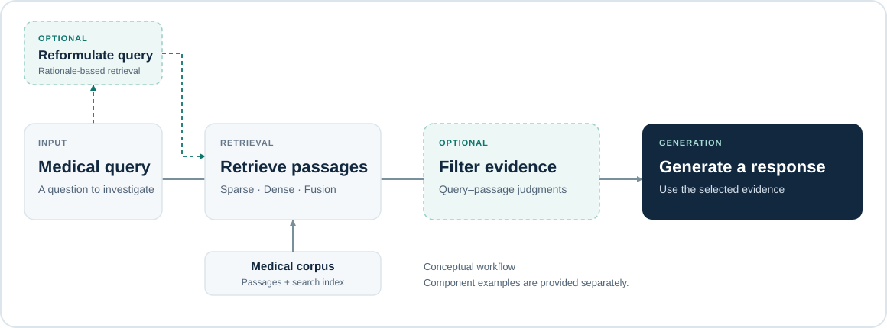

<p align="center">
  
</p>

<p align="center"><strong>Tools for evidence-grounded medical AI</strong></p>

<p align="center">
  <a href="https://arxiv.org/abs/2511.06738">📄 Paper</a> &nbsp;·&nbsp;
  <a href="https://huggingface.co/datasets/Yale-BIDS-Chen/medical-rag-expert-evaluation-200">📊 Dataset</a> &nbsp;·&nbsp;
  <a href="https://huggingface.co/Yale-BIDS-Chen/Llama-3.1-8B-Evidence-Filtering">🤗 Model</a> &nbsp;·&nbsp;
  <a href="#quick-start">⚡ Quick Start</a> &nbsp;·&nbsp;
  <a href="docs/README.md">📚 Docs</a>
</p>

Research code and reusable components for retrieval-augmented generation in medicine, including evidence retrieval, evidence filtering, and query reformulation.

<p align="center">
  
</p>

*RAG components. Query reformulation and evidence filtering are optional; the examples below demonstrate individual components.*

## Highlights

- **Flexible retrieval.** Sparse, dense, and reciprocal rank fusion retrieval over medical corpora, with support for BM25, MedCPT, and Qwen3 embeddings.
- **Evidence filtering.** A released Llama-3.1-8B-based model that labels whether a passage contains supporting evidence for a query.
- **Query reformulation.** Rationale-based queries for exploring how query formulation affects evidence retrieval.
- **Expert evaluation data.** Released questions, model responses, retrieved passages, and annotations for evaluating evidence retrieval, evidence selection, factuality, and completeness.

## Research

**[Rethinking Retrieval-Augmented Generation for Medicine: A Large-Scale, Systematic Expert Evaluation and Practical Insights](https://arxiv.org/abs/2511.06738)**

The study examines evidence retrieval, evidence selection, and response generation, and investigates evidence filtering and query reformulation as practical improvements. The released [expert evaluation dataset](https://huggingface.co/datasets/Yale-BIDS-Chen/medical-rag-expert-evaluation-200) covers **200 questions and 800 responses** from GPT-4o and Llama-3.1-8B, with and without RAG, together with **3,200 retrieved passages** and stage-specific evaluation labels.

[Read the paper](https://arxiv.org/abs/2511.06738) · [Dataset card](https://huggingface.co/datasets/Yale-BIDS-Chen/medical-rag-expert-evaluation-200) · [Research guide and code map](docs/research/rethinking-rag.md)

## Quick Start

Clone the repository and follow the [installation guide](docs/installation.md), then run a single-query retrieval example from the repository root:

```bash
python examples/quickstart.py \
  --query "What is the role of insulin in glucose metabolism?" \
  --k 3
```

This searches the **Textbooks** corpus with **MedCPT** and prints ranked passages with their titles, text, and retrieval scores. It does not generate an answer or require an LLM API key.

On the first run, the retriever downloads the corpus and model weights and prepares a local index. This requires network access and disk space; later runs reuse the saved files. See [data and indexing](docs/data-and-indexing.md) for the directory layout and preparation details.

<details>
<summary>Output format</summary>

The following is a format illustration, not a recorded retrieval result. Passage text and scores depend on the corpus and index.

```text
Query: What is the role of insulin in glucose metabolism?
Retriever: MedCPT | Corpus: Textbooks
Retrieved passages: 3

[1] <passage title>
ID: <passage id> | Score: <retrieval score>
<passage text>
```

</details>

For the available options, run `python examples/quickstart.py --help` or see the [retrieval guide](docs/retrieval.md).

## Resources

The dataset and filtering model are available in the [Medical RAG collection on Hugging Face](https://huggingface.co/collections/Yale-BIDS-Chen/medical-rag).

| Resource | Description | Link |
| --- | --- | --- |
| Expert evaluation dataset | Questions, responses, retrieved passages, and evaluation labels | [Hugging Face](https://huggingface.co/datasets/Yale-BIDS-Chen/medical-rag-expert-evaluation-200) |
| Evidence filtering model | Llama-3.1-8B-based query–passage evidence classifier | [Hugging Face](https://huggingface.co/Yale-BIDS-Chen/Llama-3.1-8B-Evidence-Filtering) |
| Single-query retrieval | Retrieve a few passages for one question | [Example](examples/quickstart.py) |
| Dataset retrieval | Retrieve passages for the MedQA test set | [Example](examples/retrieval.py) |
| Evidence filtering | Classify one query–passage pair | [Example](examples/evidence_filtering.py) |
| Rationale querying | Generate rationale-style queries, then retrieve passages | [Example](examples/retrieval_using_rationale_query.py) |

## Documentation

- [Installation](docs/installation.md) — environment, dependencies, and hardware notes
- [Retrieval](docs/retrieval.md) — retrievers, corpora, and Python usage
- [Evidence filtering](docs/evidence-filtering.md) — model, input, and output
- [Query reformulation](docs/query-reformulation.md) — rationale querying workflow
- [Data and indexing](docs/data-and-indexing.md) — corpus format, embeddings, and local indexes
- [Research guide](docs/research/rethinking-rag.md) — study overview and implementation scope

```text
medical-rag/
├── assets/        README graphics
├── docs/          Component guides and research documentation
├── examples/      Runnable component examples
├── src/           Retrieval, generation, prompts, and corpus preparation
└── requirements.txt
```

## Citation

If you use this work, please cite:

```bibtex
@article{kim2025rethinking,
  title={Rethinking Retrieval-Augmented Generation for Medicine: A Large-Scale, Systematic Expert Evaluation and Practical Insights},
  author={Kim, Hyunjae and Sohn, Jiwoong and Gilson, Aidan and
    Cochran-Caggiano, Nicholas and Applebaum, Serina and Jin, Heeju and
    Park, Seihee and Park, Yujin and Park, Jiyeong and Choi, Seoyoung and
    Herrera Contreras, Brittany Alexandra and Huang, Thomas and Yun, Jaehoon and
    Wei, Ethan F. and Jiang, Roy and Colucci, Leah and Lai, Eric and Dave, Amisha and
    Guo, Tuo and Singer, Maxwell B. and Koo, Yonghoe and Adelman, Ron A. and
    Zou, James and Taylor, Andrew and Cohan, Arman and Xu, Hua and Chen, Qingyu},
  journal={arXiv preprint arXiv:2511.06738},
  year={2025}
}
```

## Acknowledgements

This repository builds on the [MedRAG toolkit](https://github.com/Teddy-XiongGZ/MedRAG). We thank its authors and the developers of the models, datasets, and libraries used in this project.

## Disclaimer

The information produced by this repository is not intended for direct diagnostic use or medical decision-making without review and oversight by a clinical professional. Individuals should not change their health behavior solely on the basis of information produced by this repository.

## Contact

For questions or suggestions, [open an issue](https://github.com/Yale-BIDS-Chen-Lab/medical-rag/issues) or contact [Hyunjae Kim](mailto:hyunjae.kim@yale.edu) or [Qingyu Chen](mailto:qingyu.chen@yale.edu).
